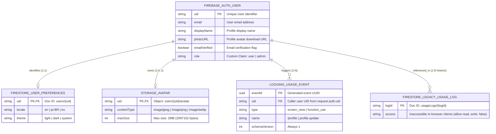

# Entity-relationship diagram

## Status: pending product persistence model

The product domain and its entity-relationship diagram (ERD) remain pending.
The template already stores technical user preferences in Firestore and avatar
objects in Storage; this is not a defined business entity model. When a product
model is adopted, document entities, relevant attributes, relationships,
cardinalities, and integrity constraints here.

The UI and AI Elements libraries do not establish a product persistence model.
When that model is adopted, record its decision in `docs/adr/` and update
[ARCHITECTURE.md](ARCHITECTURE.md) together with this diagram.

Do not add speculative entities or relationships to this document: they must
reflect the adopted domain and persistence implementation.

## Existing technical persistence

`src/app/(protected)/profile/_lib/data.ts` reads and merges `locale` and
`theme` at `users/{uid}`. `firestore.rules` permits access only to the matching
authenticated UID and validates allowed fields and values. Avatar objects live
at `users/{uid}/avatar`, governed by `storage.rules`; Auth profile attributes
remain in Firebase Authentication. These stores do not establish a cross-service
transaction or a relational foreign key.

See [Architecture](ARCHITECTURE.md#runtime-and-component-boundaries) and
[Security](SECURITY.md). A shadcn/ui component, form schema, registry manifest,
or upstream documentation refresh does not adopt a product persistence model.
